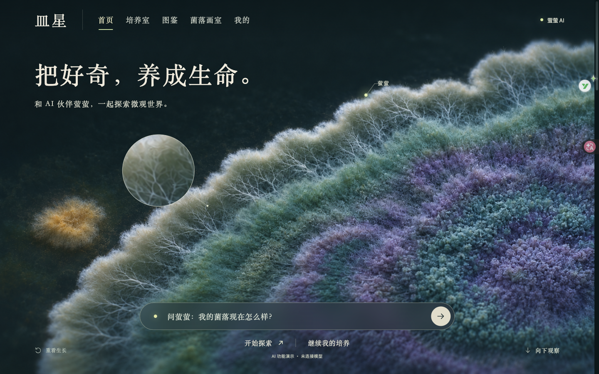

# 皿星 MINXING

**把好奇，养成生命。**

皿星是一款面向学生的虚拟微生物培养产品原型。用户从观察菌落开始，选择菌种与培养条件，在 3D 展台和数据监控之间切换，记录发现、查看图鉴，也可以用菌落颜色进行创作。AI 伙伴「萤萤」的设计目标，是结合当前培养记录帮助用户理解变化、提出问题、比较条件。

**当前阶段：在线真实模型试用。首页和培养室通过云端 Cloudflare Worker 调用 Qwen，读取提问时的培养快照。培养数值、推荐配置和条件试算仍由本地教学程序提供，不代表真实实验测量或经验证的生物学预测。**



## 版本说明

[2026-11-08 冻结版本说明](docs/RELEASE-NOTES.md)记录此前展示版范围；当前模型接入情况以本 README 为准。个人汇报与面试准备材料在本地单独保存，不包含在本仓库中。

## 在线体验

[打开皿星](https://buu206.github.io/minxing/)

前端部署于 GitHub Pages；后端为作者 Cloudflare 账号下的 `minxing-ai` Worker。Qwen 密钥仅存于 Worker Secret。全站每日最多 50 次请求尝试（北京时间零点恢复），每 IP 每分钟最多 3 次；失败也计数。达到上限不影响培养和展示功能。问题、最近对话和培养快照会发送至阿里云百炼。

后端维护源码与部署说明见 [backend/README.md](backend/README.md)。D1 保存限额计数，不保存对话或培养记录；浏览器培养存档仍不跨设备同步。

## 本地运行

页面和真实 AI 一起启动：

```sh
npm start
```

打开 <http://127.0.0.1:18778/colony.html#home>。需要换端口时执行 `PORT=18777 npm start`。模型网关仅监听本机，不能作为远程访问地址。

网关默认读取仓库上一级的 `皿星-本地配置/.env`，也可通过 `MINXING_ENV_FILE` 指定绝对路径。配置文件放在仓库外，填写：

```dotenv
MINXING_MODEL_PROVIDER=aliyun
MINXING_MODEL_BASE_URL=https://dashscope.aliyuncs.com/compatible-mode/v1
MINXING_MODEL=qwen3.7-plus-2026-05-26
MINXING_MODEL_API_KEY=填写自己的密钥
```

配置保存后重启服务。密钥只由 Python 网关读取，不写入浏览器、HTML 或 Git。用户问题、最近对话和当前培养摘要会发送到模型供应商。每次提问会产生 API 用量。直接双击 HTML 或运行静态预览时，模型问答不可用。

原型的 Three.js 模块与图片已内置；外部字体不可用时使用系统字体。3D 展台依赖浏览器 WebGL。培养记录保存在当前浏览器的本地存储中，换浏览器、端口或域名不会自动同步。本仓库上传不包含任何人的运行存档。

## 当前能体验什么

- 同一菌群近景拉开的约 3 秒进场、局部呼吸动效、鼠标放大镜。
- 首页随滚动收拢菌群景观，衔接可操作培养皿，再进入图鉴与画室内容。
- 新建培养、接种、观察视角、培养条件调整、监控、发现记录、图鉴、复盘与画室等原型流程。
- 首页和培养室的真实模型问答；提供培养状态、预设配置与条件试算作为回答依据，显示来源和快照过时提示。操作仍需用户点击确认。
- 手机触摸适配、减少动态偏好、首页不可见时暂停相关绘制。

当前是携带结构化培养上下文的模型问答，尚无模型自主选择工具的 Agent 循环、知识检索或图像识别。两个入口共享当前页面内最多 12 条历史消息；切换培养皿会重置模型上下文。首页展示对话刷新后不保留，培养室展示对话另有本地存档。账号、云端同步、课堂和家长模块未接入。

## 开发与构建

需要 Node.js / npm 和 Python 3。依赖固定为 esbuild `0.25.12`，Three.js `0.165.0` 已放在 `src/vendor/`。

```sh
npm ci
npm run build
npm run preview
```

构建重新生成根目录的 `colony.html`。根目录 `index.html` 只负责转到当前原型，便于静态托管；主分支更新后 GitHub Pages 自动发布。Cloudflare 后端需要单独部署。

```text
colony.html             当前可直接运行的完整原型
src/original.html       组合构建使用的既有业务原型快照
src/home.*              首页布局与滚动交互
src/life-visual.js       菌群动效、放大镜和视觉生命周期
src/intro.*             同景进场
src/assistant.*         首页对话与程序计算的操作建议
src/live-ai.js          两个对话入口的模型请求与上下文
server.py               本地模型网关（只对外提供页面与 API）
src/build.cjs           单文件打包入口
src/compose.py          将模块组合进业务原型
src/vendor/             Three.js 本地模块与原始许可证
docs/                   版本说明、截图与验证记录
```

2026-11-08 汇报版本保留在 Git 历史中；2026-11-09 起接入真实模型与云端后端。代码由既有原型和 AI 辅助迭代组成；历史版本仍在作者本机归档。仓库不默认赋予项目代码与设计素材开源许可证；Three.js 等第三方内容按各自许可证使用。
